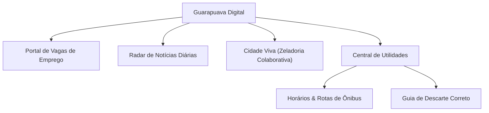
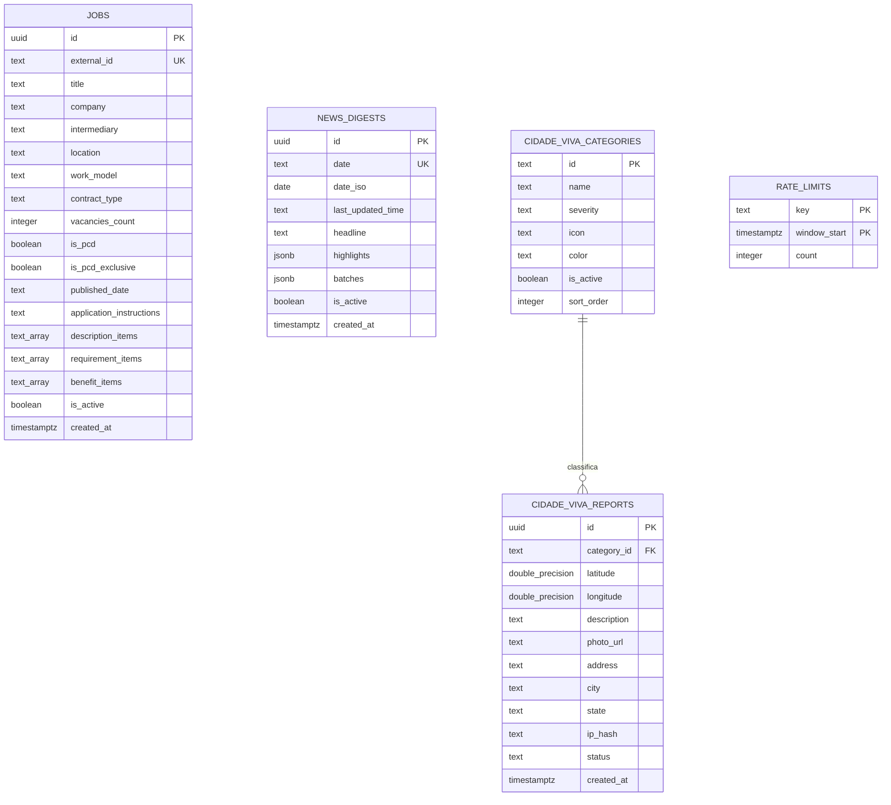

# 📖 Documentação Completa do Projeto: **Guarapuava Digital**

---

## 1. Visão Geral e Propósito

O **Guarapuava Digital** ([guarapuava.digital](https://guarapuava.digital)) é uma plataforma web hiperlocal progressiva projetada especificamente para os cidadãos de **Guarapuava (Paraná)**. 

O projeto nasceu para resolver uma dor crônica da cidade: **a dispersão de informações essenciais do cotidiano**. Em vez de exigir que o morador navegue por dezenas de sites lentos da prefeitura, PDFs governamentais estáticos, posts em grupos de Facebook ou murais de emprego com cadastros burocráticos, o Guarapuava Digital consolida os principais serviços e utilidades públicas municipais em um ambiente ultrarrápido, leve, direto e de altíssima fidelidade visual.

### Pilares Fundamentais:
1. **Zero Fricção:** Sem barreiras de autenticação ou preenchimento de cadastros para o usuário comum consultar vagas, notícias, ônibus ou locais de descarte.
2. **Mobile-First Realista:** Otimizado para conexões móveis 3G/4G, com baixa latência, carregamento instantâneo e layout adaptado ao uso com uma mão.
3. **Automação Contínua:** Agentes inteligentes e rotinas agendadas (cron/webhooks) mantêm dados de vagas e resumos noticiosos sempre frescos sem esforço manual redundante.

---

## 2. Público-Alvo e Posicionamento

* **Usuários Primários:** Trabalhadores, estudantes, passageiros do transporte coletivo e moradores em geral de Guarapuava.
* **Contexto de Acesso:** Majoritariamente através de smartphones (iOS/Android), frequentemente a partir de links compartilhados no WhatsApp e redes sociais. Por isso, a plataforma conta com suporte rigoroso a *Open Graph*, permitindo pré-visualizações perfeitas ao compartilhar vagas ou notícias no WhatsApp.
* **Rejeição a Clichês:** A plataforma não usa interfaces genéricas de templates nem elementos visuais decorativos supérfluos. Ela se posiciona como uma **utilidade pública elegante e confiável**.

---

## 3. Os Módulos da Aplicação



### 3.1. Portal de Vagas de Emprego (`/` e visualização de Vagas)
* **Objetivo:** Conectar candidatos às vagas de emprego reais de Guarapuava (com captações da Agência do Trabalhador/SINE, agências parceiras como Vehlor e anúncios de empresas locais).
* **Funcionalidades:**
  * Busca universal instantânea por cargo, empresa ou palavras-chave.
  * Filtros combináveis em três estados: Regime de contratação (Todos / CLT / PJ), acessibilidade PcD (Todos / Somente PcD / Aceita PcD) e experiência (Todos / Com experiência / Sem experiência).
  * Filtro de favoritos e marcação local de vagas visualizadas.
  * Cartão detalhado da vaga com requisitos, atribuições, salário, benefícios, jornada e endereço de inscrição.
  * **Candidatura em 1 Clique:** Botão que abre diretamente o WhatsApp do recrutador com uma mensagem formal pré-formatada ou link direto para envio de currículo.

### 3.2. Radar de Notícias Diárias (`/` - Feed de Notícias)
* **Objetivo:** Oferecer um boletim do dia condensado, direto e livre de caça-cliques (*clickbaits*).
* **Funcionalidades:**
  * Manchete síntese do dia elaborada com visão editorial focada nos fatos municipais.
  * Histórico de boletins por data (*Daily Digests*) com ordenação temporal.
  * Itens divididos por lote cronológico (com selos de horário no padrão tabular).
  * Filtro por categorias temáticas (Cidade, Obras, Trânsito, Educação, Saúde, Concursos, etc.).

### 3.3. Cidade Viva — Mapeamento Colaborativo (`/cidade-viva`)
* **Objetivo:** Um canal aberto, anônimo e georreferenciado para a comunidade reportar e acompanhar ocorrências de zeladoria urbana e infraestrutura na cidade.
* **Categorias Mapeadas:**
  * Asfalto e buracos na via, vazamento de água/esgoto, risco elétrico/postes apagados, semáforos quebrados, lixo/entulho acumulado, queda de galhos/árvores, calçadas danificadas, focos de dengue e alagamentos.
* **Funcionalidades:**
  * **Mapa Interativo (MapLibre GL):** Navegação fluida, clusterização automática de pinos com cores e ícones específicos de severidade (`alto`, `medio`, `baixo`).
  * **Relato Fácil com Foto:** Envio de foto tirada na hora (com compressão automática e limite de 2MB), captura automática de coordenadas GPS via navegador e geocodificação reversa de endereço.
  * **Moderação e Gestão Administrativa (`/admin/cidade-viva`):** Área restrita protegida por Supabase Auth para atualização de status dos chamados (*Sugestivo* $\rightarrow$ *Confirmado pela comunidade* $\rightarrow$ *Verificado in loco* $\rightarrow$ *Resolvido*).

### 3.4. Horários & Rotas de Ônibus (`/utilidades/onibus`)
* **Objetivo:** Substituir tabelas confusas da operadora municipal Pérola do Oeste por um planejador de mobilidade inteligente.
* **Funcionalidades:**
  * Grade completa de todas as linhas e bairros de Guarapuava com horários separados para Dias Úteis, Sábados e Domingos.
  * **Calculador de Rotas Ponto a Ponto:** O usuário pode selecionar ponto de embarque (origem) e desembarque (destino) para calcular o itinerário, paradas intermediárias e estimativa de tempo.
  * Suporte a geolocalização do usuário para encontrar paradas mais próximas.
  * Salvamento offline de rotas favoritas no navegador (`localStorage`).

### 3.5. Guia de Descarte Correto (`/utilidades/descarte`)
* **Objetivo:** Orientar a população sobre o destino correto para resíduos que não devem ser despejados no lixo comum.
* **Funcionalidades:**
  * Catálogo de itens: pilhas/baterias, óleo de cozinha usado, eletrônicos, pneus, lâmpadas, remédios vencidos, móveis velhos, vidros, etc.
  * Busca por palavra-chave ou filtro por categorias.
  * Fichas detalhadas dos pontos de entrega voluntária (PEVs), cooperativas, secretarias municipais e comércios credenciados, com endereço, telefone e horário de funcionamento.

---

## 4. Design System: "O Painel de Rádio"

A identidade visual do Guarapuava Digital está formalizada no arquivo `DESIGN.md` e obedece a regras de design estritas:

### Inspiração
A estética segue o conceito do **"Painel de Rádio" dos anos 60 (estilo Dieter Rams / Braun)**: a interface é tratada como um bloco tátil esculpido em uma placa de alabastro fosco.

### Paleta Cromática
* **Alabastro (`#eff0f3` - `canvas`):** Cor de fundo única compartilhada por toda a página, pelos cartões, pelo rodapé e pelas teclas. **A regra "The One Surface Rule":** Não existem cartões com fundos coloridos artificiais; a diferenciação de profundidade é feita exclusivamente por luz e sombra.
* **Tinta (`#191c1f` / `#34383d` / `#585d62`):** Tipografia com hierarquia nítida de pesos e contraste acessível (mínimo de 5.9:1).
* **Coral Sinal (`#ff4742` - `coral`):** **Regra "The LED Rule":** A cor coral é empregada como o LED de um aparelho eletrônico (marcação de tópicos ativos, pontos pulsantes de "ao vivo", anéis de foco). **Nunca é usada para preencher blocos inteiros.**

### Elevação e Neumorfismo Refinado
* Efeito de iluminação consistente com luz fixa no canto superior esquerdo e sombras azuis-acinzentadas no canto inferior direito:
  * **Elemento em repouso:** Alto-relevo (`raised`), sombra clara projetada.
  * **Elemento ativado / selecionado:** Baixo-relevo afundado (`inset`), transmitindo a física de uma tecla pressionada.

### O Rodapé Fixo Canônico (`Dock`)
* O componente `Dock` permanece idêntico em todas as telas mobile, fixado na base com compensação para *Safe Area* de smartphones e efeito de desvanecimento (*gradient fade*) para o conteúdo rolar por trás dele.

---

## 5. Arquitetura de Software e Tecnologias

```
Next.js 16 (App Router) + React 19 + TypeScript
 │
 ├── Frontend / Client State:
 │    ├── Tailwind CSS v4 (Design tokens nativos)
 │    ├── Lucide React (Ícones consistentes)
 │    ├── MapLibre GL (Renderização de mapas vetoriais)
 │    └── Context / LocalStorage (Preferências de temas e favoritos)
 │
 ├── API Layer & Server Actions:
 │    ├── /api/cron/sync-jobs & sync-news (Sincronização agendada)
 │    ├── /api/webhooks/docs-sync (Acionamento sob demanda via Google Docs)
 │    ├── /api/mcp/route.ts (Servidor MCP para agentes autônomos)
 │    └── Server Actions (/cidade-viva/actions.ts e actions-admin.ts)
 │
 └── Backend as a Service (Supabase):
      ├── PostgreSQL 15+ (Tabelas, índices, constraints e tipos)
      ├── Row Level Security (RLS) & Views Seguras
      ├── Funções PL/pgSQL Security Definer (Rate limiting com chave)
      ├── Storage Buckets (Armazenamento de imagens)
      └── Supabase Auth (Painel administrativo)
```

### Agente e Protocolo MCP (*Model Context Protocol*)
O projeto conta com uma API própria compatível com a especificação **MCP da Anthropic** em `src/app/api/mcp/route.ts`, permitindo que agentes de inteligência artificial (como o *Gemini Spark Agent*) interajam diretamente com o banco de dados da aplicação através de ferramentas formais:
1. `listar_vagas_ativas`: Consulta o estado atual das vagas.
2. `sincronizar_vagas`: Faz a ingestão idempotente de vagas com validação estrutural via Zod.
3. `desativar_vaga`: Marca vagas preenchidas como inativas.

---

## 6. Banco de Dados e Modelagem (Supabase / Postgres)

O banco de dados é estruturado em migrações SQL versionadas na pasta `supabase/migrations`:



### Resumo das Tabelas e Propósitos:
1. **`jobs`:** Armazena as vagas de emprego. Utiliza o `external_id` (um hash/slug composto de título + empresa + url de origem) para garantir idempotência durante a sincronização automática.
2. **`news_digests`:** Armazena as edições diárias do Radar de Notícias. O campo `batches` armazena em formato JSONB os blocos de notícias organizados por horário.
3. **`cidade_viva_categories`:** Tabela de domínio com as categorias do mapa, níveis de severidade (`alto`, `medio`, `baixo`, `assistencial`) e ícones.
4. **`cidade_viva_reports`:** Guarda as ocorrências urbanas criadas pela população, com coordenadas precisas, URL da foto e `ip_hash` para moderação.
5. **`cidade_viva_reports_public` (View):** Criada com `WITH (security_invoker = true)` para omitir dados de telemetria sensíveis (como `ip_hash`) de qualquer requisição pública anônima.
6. **`rate_limits`:** Tabela interna gerenciada pela função PL/pgSQL `check_rate_limit()` com segurança estrita para barrar tentativas de spam e negação de serviço.
7. **`storage.buckets ('cidade-viva-reports')`:** Bucket público com limite de 2MB por imagem e validação estrita de MIME types (`image/jpeg`, `image/png`, `image/webp`).

---

## 7. Segurança e Proteção

O projeto foi submetido a um processo de endurecimento de segurança (*security hardening*):
* **Row Level Security (RLS) Ativo:** Todas as tabelas públicas operam sob RLS. Usuários anônimos têm permissão estrita de `SELECT` apenas para registros ativos e campos públicos.
* **Proteção contra Enumeração e Vazamento:** A coluna `ip_hash` teve suas permissões de `SELECT` revogadas para o papel `anon` e `authenticated`. A listagem direta de arquivos dentro do bucket de storage foi desativada.
* **Rate Limiting em Camada Dupla:**
  1. No nível da API: O endpoint do servidor valida os cabeçalhos de IP e chama `check_rate_limit` no Postgres.
  2. Proteção contra Timing Attacks: As rotas de Cron e MCP usam a função `safeTimingCompare` com `crypto.timingSafeEqual` para comparar tokens de autorização sem expor vulnerabilidades de tempo.
* **Validação de Schemas:** Entradas do usuário em formulários e requisições de agentes externos são validadas através da biblioteca **Zod**.

---

## 8. Estrutura de Diretórios do Projeto

```
guarapuava/
├── DESIGN.md                 # Especificação canônica do Design System
├── PRODUCT.md                # Diretrizes de produto, usuários e posicionamento
├── DOCUMENTACAO.md           # Esta documentação completa do sistema
├── package.json              # Dependências e scripts do projeto
├── supabase/
│   └── migrations/           # Scripts SQL de schema, RLS e funções do banco
├── scripts/                  # Scripts de automação, sincronização e crawlers
│   ├── run-gemini-agent.ts   # Execução do agente Gemini
│   ├── run-docs-sync.ts      # Sincronização de vagas via Google Docs
│   └── crawler-horarios-onibus.py # Coleta de dados dos ônibus
├── src/
│   ├── app/                  # Rotas do Next.js (App Router)
│   │   ├── page.tsx          # Página principal (Vagas e Notícias)
│   │   ├── admin/            # Painel administrativo de moderação
│   │   ├── api/              # Rotas de Cron, Webhooks e Servidor MCP
│   │   ├── cidade-viva/      # Módulo Cidade Viva (apresentação e mapa)
│   │   └── utilidades/       # Módulo Utilidades (ônibus e descarte)
│   ├── components/           # Componentes modulares de UI, feeds e mapa
│   │   ├── ui/               # Componentes táteis (Dock, Key, Presença, etc.)
│   │   ├── bus/              # Componentes de itinerários e linhas de ônibus
│   │   └── descarte/         # Componentes do guia de descarte correto
│   ├── context/              # Contextos globais (tema claro/escuro)
│   ├── data/                 # Bases de dados locais e estáticas (JSONs de ônibus e PEVs)
│   ├── hooks/                # Hooks React utilitários (geolocalização, estado)
│   ├── lib/                  # Bibliotecas internas de lógica de negócios
│   │   ├── bus/              # Lógica de cálculo de rotas de ônibus
│   │   ├── descarte/         # Lógica de filtragem e busca de descarte
│   │   ├── docs/             # Parsers de sincronização de documentos
│   │   ├── mcp/              # Implementação das ferramentas do protocolo MCP
│   │   └── supabase/         # Clientes Supabase para Client e Server
│   └── types/                # Definições de tipos TypeScript
```

---

## 9. Como Executar e Trabalhar no Projeto

### Pré-requisitos
* Node.js 20+ instalado
* Conta/Projeto no Supabase configurado (com as variáveis de ambiente em `.env.local`)

### Comandos Principais
```bash
# Instalar dependências
npm install

# Iniciar servidor de desenvolvimento (porta 3000)
npm run dev

# Executar linter
npm run lint

# Sincronizar dados de vagas a partir do Google Docs
npm run sync:docs

# Sincronizar notícias a partir do Google Docs
npm run sync:news

# Disparar agente inteligente do Gemini
npm run sync:gemini

# Compilar para produção
npm run build
```
